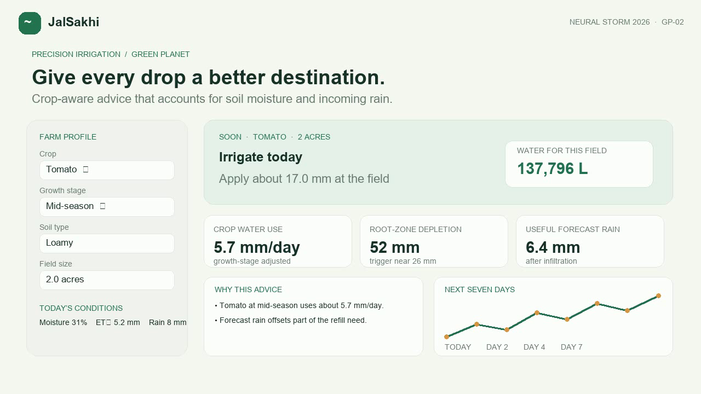

# JalSakhi — Give every drop a better destination

**Neural Storm 2026 · Green Planet · GP-02: AI-Based Precision Irrigation Advisory**

JalSakhi is a farmer-facing irrigation planning prototype. It combines crop, growth stage, soil type, field size, soil moisture, reference evapotranspiration, and expected rain to estimate whether to irrigate, how much water to apply, and why. The dashboard shows a seven-day water-balance outlook and expresses the recommendation in litres per acre.

## Why this problem

Irrigation decisions made without considering crop stage, soil, or incoming rain can waste water and energy or leave crops stressed. JalSakhi makes those tradeoffs visible in a short, explainable recommendation that can work from manually entered values when connectivity is limited.

## Approach

The Python advisory engine uses a simplified, transparent water balance inspired by FAO-56 crop-coefficient methods:

1. Estimate crop use from reference evapotranspiration × crop coefficient × growth-stage factor.
2. Estimate root-zone storage from soil type and crop rooting depth.
3. Estimate depletion from the soil moisture input and compare it with a crop-specific trigger.
4. Discount forecast rain by a soil infiltration estimate, then calculate a capped refill recommendation.
5. Show reasons, a water volume conversion, and a seven-day planning chart.

This is an **agronomy-informed decision-support prototype**, not a trained or field-calibrated ML model. It does not fetch live sensor or forecast data. The default values are editable demo inputs. All crop parameters are simplified illustrative values and should be reviewed by an agronomist before real-world use.

## Run locally

Requires Python 3.10 or newer.

```bash
python -m venv .venv
# Windows: .venv\Scripts\activate
# macOS/Linux: source .venv/bin/activate
pip install -r requirements.txt
streamlit run app.py
```

Open the local URL shown by Streamlit. Use the sidebar to change the crop, growth stage, soil, acreage, moisture, evapotranspiration, and forecast rain. The starting profile is pre-filled for a quick demo.

## Demo flow

1. Start with the default tomato field and note the irrigation amount.
2. Increase forecast rain to 40 mm; the advice should account for useful rain.
3. Switch to rice and adjust soil moisture; the root-zone estimate and recommendation update.
4. Expand “How JalSakhi makes this estimate” to show the transparent method and limitations.

## Tech stack

- Python 3.10+
- Streamlit
- Pandas
- Plotly

## Performance and evaluation

This version is a deterministic decision-support calculation, not a fitted predictive model. It has no claimed accuracy or field validation. Recommendation inputs, intermediate values, and water units are visible so a domain expert can review the assumptions. A next validation step is to compare water-use estimates and field outcomes with local agricultural extension guidance across crops, soils, and irrigation methods.

## Team

- Team: JalSakhi
- Members: Add participant names before submission.

## AI tools

OpenAI Codex (GPT-6) assisted with project planning, Python implementation, interface copy, and README drafting. Final parameter choices and field use should be reviewed by the team and a local agronomy expert.

## Responsible use

Prototype estimates are illustrative. JalSakhi is not a live forecast service, a sensor system, or a substitute for local agricultural advice. Do not use its outputs as field instructions without checking local conditions and crop-specific guidance.

## License

MIT. See [LICENSE](LICENSE).

## Demo



[Watch the 2:47 narrated walkthrough](demo.mp4). It shows tomato, rice, wheat, and cotton scenarios, including how a rain forecast can change the recommendation. The interface movement is an animated walkthrough, not a screen recording. Narration was generated with Windows speech synthesis.
