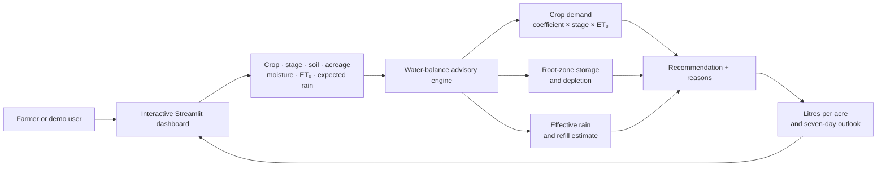

<div align="center">

# 💧 JalSakhi - Give every drop a better destination.

**An explainable irrigation planner for crop, soil, moisture, and rain.**

**Neural Storm 2026 · Green Planet · GP-02: AI-Based Precision Irrigation Advisory**  

**Team:** Error 007 · **Member:** Arihant Jain

[🌐 Open the live app](https://jalsakhi-waterwise.streamlit.app/) &nbsp;·&nbsp; [🎥 Watch the narrated demo](demo.mp4) &nbsp;·&nbsp; [📦 Explore the code](https://github.com/Arihant2007/JalSakhi)


</div>

---

> A farmer should not have to guess whether tomorrow's rain is enough, or how much water a field needs today. JalSakhi puts those tradeoffs into a clear, interactive plan.

**Architecture · Features · Sample result · Quick start · Demo flow · Method · Responsible use**

## 🌱 Why JalSakhi

Watering decisions depend on more than the crop. Growth stage changes water demand; soil changes how much water the root zone can hold; and incoming rain can make irrigation unnecessary. When these factors are considered separately, farmers can waste water and energy or leave crops under stress.

JalSakhi brings those factors into one farmer-facing dashboard. Change the field assumptions and immediately see the recommendation, estimated water volume, seven-day outlook, and the reasons behind the result.

## ✨ What you can explore

| | Feature | In the app |
|---|---|---|
| 🌾 | **Multiple crops** | Compare rice, wheat, tomato, cotton, and groundnut across growth stages. |
| 🌧️ | **Rain-aware planning** | See how expected rain and soil infiltration affect the refill estimate. |
| 🧮 | **Explainable advice** | Read the key inputs and reasons behind each recommendation. |
| 💧 | **Field-ready units** | View irrigation depth and estimated litres per acre, scaled to field size. |
| 📈 | **Seven-day outlook** | Explore estimated root-zone depletion and crop water use. |
| 🎛️ | **Interactive controls** | Adjust crop, soil, acreage, moisture, evapotranspiration, and expected rain. |
| 🔊 | **Narrated walkthrough** | Watch crop scenarios with ElevenLabs “Raju - Clear, Natural and Warm” narration. |

## 🏗️ How it works

JalSakhi uses a transparent, agronomy-informed water-balance calculation. The interface collects field assumptions, the advisory engine estimates crop demand and root-zone depletion, then the app shows a recommendation with reasons and a planning outlook.



### The calculation, in brief

1. Estimate daily crop water use from reference evapotranspiration × crop coefficient × growth-stage factor.
2. Estimate root-zone water capacity from soil type and crop rooting depth.
3. Compare estimated depletion with the crop's irrigation trigger.
4. Discount forecast rain using a simplified soil infiltration estimate and calculate a capped refill recommendation.
5. Show the suggested amount, water-volume conversion, reasoning, and seven-day planning chart.

## 📸 See it in action


### Example: tomato · mid-season · loamy soil

With the demo field's default inputs, JalSakhi recommends **irrigating today** with an estimated **17 mm** at the field, or about **68,898 litres per acre**. The app also shows the assumed root-zone depletion, effective forecast rain, and why it made that recommendation. Change any input in the app to explore a different scenario.

> These figures are an illustrative demo result, not a field-calibrated prescription.

🎥 **[Play the 2:41 narrated walkthrough](demo.mp4)** — see tomato, rice, wheat, and cotton scenarios, including how increasing forecast rain changes the advice. Interface movement is an animated walkthrough, not a screen recording.

## 🚀 Run it locally

Requires Python 3.10 or newer.

```bash
git clone https://github.com/Arihant2007/JalSakhi.git
cd JalSakhi

python -m venv .venv
# Windows: .venv\Scripts\activate
# macOS/Linux: source .venv/bin/activate
pip install -r requirements.txt
streamlit run app.py
```

Open the local URL printed by Streamlit. The starting profile is pre-filled; use the sidebar to explore crop, growth stage, soil, field size, soil moisture, ET₀, and expected rain.

## 🎮 A quick demo route

1. Start with the tomato field and note the recommended depth and litres per acre.
2. Raise expected rain to **40 mm** and see how useful rain changes the plan.
3. Switch to **rice**, then adjust moisture and soil to compare root-zone estimates.
4. Try **wheat** and **cotton**, then open “How JalSakhi makes this estimate” to review the method and limitations.

## 🧰 Built with

| Layer | Technology |
|---|---|
| Interactive dashboard | Streamlit |
| Advisory calculation | Python |
| Data handling | Pandas |
| Charts | Plotly and Streamlit charts |
| Demo voiceover | ElevenLabs text-to-speech |

## 📏 Evaluation and next step

This version is a deterministic decision-support calculation, not a fitted predictive model. It makes no accuracy or field-validation claim. Inputs, intermediate values, and units are visible so the assumptions can be reviewed. The next validation step is to compare estimates with local agricultural extension guidance and field outcomes across crops, soils, and irrigation methods.

## ⚠️ Responsible use

JalSakhi is an educational prototype. It does not connect to live sensors or weather forecasts; the values are entered by the user. Crop parameters are simplified and are not calibrated for a specific region. Check local conditions and consult crop-specific agricultural guidance before using estimates in the field.

## 👥 The team

| | |
|---|---|
| **Team** | Error 007 |
| **Member** | Arihant Jain |
| **Challenge** | Neural Storm 2026 · Green Planet |
| **Problem statement** | GP-02 · AI-Based Precision Irrigation Advisory |

## 🤖 AI tools

OpenAI Codex assisted with project planning, Python implementation, interface copy, and README drafting. ElevenLabs generated the narrated demo voiceover. Final parameters and any real-world use should be reviewed by the team and a local agronomy expert.

## 📄 License

MIT — see [LICENSE](LICENSE).
