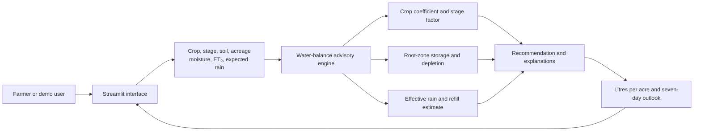

<div align="center">
    
# 💧 JalSakhi — Give every drop a better destination

**Neural Storm 2026**  

**Problem Statement:** GP-02 (AI-Based Precision Irrigation Advisory)

**Team:** Error 007 · **Member:** Arihant Jain

An explainable irrigation planning tool that helps farmers compare crop, growth stage, soil, field size, soil moisture, evapotranspiration, and expected rain. JalSakhi estimates whether irrigation is needed, how much water to apply, and why, then shows a seven-day water-balance outlook.

🌐 [Live app](https://jalsakhi-waterwise.streamlit.app/) · 📦 [GitHub](https://github.com/Arihant2007/JalSakhi) · 🎥 [Narrated demo](demo.mp4)

**Architecture · Features · Quick Start · Demo · Method · Limitations · Team**

## 💡 Problem statement

Irrigation decisions made without considering crop stage, soil, or incoming rain can waste water and energy or leave crops stressed. GP-02 asks for an AI-based precision irrigation advisory. JalSakhi addresses this with a transparent, crop-aware water-balance estimate that can be explored using manually entered values, including where connectivity is limited.

## ✨ Features

| Feature | What it does |
|---|---|
| 🌱 Multi-crop guidance | Compare tomato, rice, wheat, and cotton across growth stages. |
| 🌧️ Rain-aware estimate | Account for forecast rain when estimating a refill recommendation. |
| 🧮 Explainable calculation | Show the inputs and reasoning behind each irrigation estimate. |
| 📈 Seven-day outlook | View a short water-balance planning chart. |
| 💧 Practical units | Express recommended depth and estimated volume in litres per acre. |
| 🎛️ Interactive controls | Change crop, soil, acreage, moisture, evapotranspiration, and rain to see results update. |
| 🔊 Narrated walkthrough | Watch a 2:41 walkthrough with ElevenLabs narration and multiple crop scenarios. |

## 🏗️ Architecture

The Streamlit interface collects editable field and weather assumptions, passes them to a deterministic advisory engine, and presents the recommendation with its reasons and planning chart.



### Calculation flow

1. Estimate crop use from reference evapotranspiration × crop coefficient × growth-stage factor.
2. Estimate root-zone storage from soil type and crop rooting depth.
3. Estimate depletion from the entered soil moisture and compare it with a crop-specific trigger.
4. Discount expected rain by a soil infiltration estimate, then calculate a capped refill recommendation.
5. Explain the result and display water-volume conversion and a seven-day planning chart.

## 📸 Demo


[Watch the 2:41 narrated walkthrough](demo.mp4). It shows tomato, rice, wheat, and cotton scenarios, including how a rain forecast can change the recommendation. The interface movement is an animated walkthrough, not a screen recording. Narration uses the ElevenLabs “Raju - Clear, Natural and Warm” voice.

## 🚀 Quick Start

Requires Python 3.10 or newer.

```bash
git clone https://github.com/Arihant2007/JalSakhi.git
cd JalSakhi

python -m venv .venv
# Windows: .venv\Scripts\activate
# macOS/Linux: source .venv/bin/activate
pip install -r requirements.txt
streamlit run app.py
```

Open the local URL shown by Streamlit. Use the sidebar to change crop, growth stage, soil, acreage, soil moisture, evapotranspiration, and forecast rain.

## 🎮 Suggested demo flow

1. Start with the default tomato field and note the irrigation amount.
2. Increase forecast rain to 40 mm and observe how useful rain affects the advice.
3. Switch to rice and adjust soil moisture to see the root-zone estimate and recommendation update.
4. Try wheat and cotton, then inspect the method and limitations shown in the app.

## 🛠 Tech stack

| Layer | Choice |
|---|---|
| Interface | Streamlit |
| Advisory engine | Python |
| Data handling | Pandas |
| Planning chart | Plotly |
| Demo narration | ElevenLabs text-to-speech |

## 📊 Performance and evaluation

JalSakhi is a deterministic decision-support calculation, not a fitted predictive model. It has no claimed accuracy or field validation. Inputs, intermediate values, and water units are visible for review. A useful next validation step is to compare estimates and field outcomes with local agricultural extension guidance across crops, soils, and irrigation methods.

## ⚠️ Limitations and responsible use

This is an agronomy-informed prototype, not a trained or field-calibrated ML model. It does not fetch live sensor or forecast data; users enter the demo values. Crop parameters are simplified illustrative values. Review them with an agronomist before field use. Do not treat the output as a substitute for local conditions or crop-specific advice.

## 👥 Team

- **Team name:** Error 007
- **Member:** Arihant Jain
- **Problem statement:** GP-02 — AI-Based Precision Irrigation Advisory

## 🤖 AI tools

OpenAI Codex assisted with project planning, Python implementation, interface copy, and README drafting. ElevenLabs was used to generate the narrated demo voiceover. Final parameter choices and field use should be reviewed by the team and a local agronomy expert.

## 📄 License

MIT. See [LICENSE](LICENSE).
